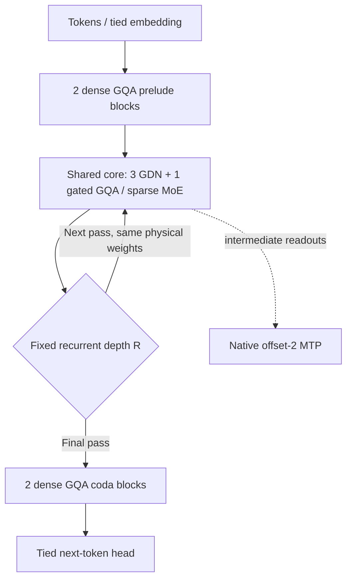

# SPLOT — Sparse Predictive Looped Optimized Transformer

[Polski](README.pl.md) · [Research charter](research/CHARTER.md) · [Architecture contract](research/rfcs/0001-architecture/contract-v0.2.md) · [Research status](PROJECT_STATE.md) · [Evidence](experiments/results/INDEX.md) · [Roadmap](ROADMAP.md)

**Achieve more through better architecture, not greater scale.**

An independent, open architecture-first research programme investigating better language-model quality at equivalent or lower computational cost. Commodity hardware is an initial validation constraint, not the research objective. See the [foundational charter](research/CHARTER.md) and [evaluation framework](research/evaluation/README.md).

SPLOT (Polish for an interweaving) combines recurrent depth, hybrid Gated DeltaNet / grouped-query attention (GDN/GQA), sparse mixture-of-experts (MoE), native multi-token prediction (MTP), and native low-precision training. The aim is to understand whether these mechanisms together improve the quality–compute–latency–memory frontier, not to assume that any component guarantees acceleration.

**Current status — 28 November 2026: working research architecture, native CUDA training validated; first bounded real-data feasibility pilot completed.** The reference is implemented and trainable, with public, revision-pinned CPU/GPU experiment evidence. No production language model or public pretrained weights are released. This is independent research, not affiliated with PLLuM, NASK or another institution.

## Architecture



- Eight physical blocks; fixed 1–4 recurrent passes, separate causal state per logical execution.
- Eight routed experts per core FFN, top-2 routing plus a shared expert; FP32 router and load balancing.
- Native offset-2 MTP and exact D1/D2 speculative reference with accepted D0 baseline and trace v2 ([T0018](experiments/results/T0018/attempt-002/summary.md)); trained-checkpoint acceptance and latency evaluation remain open.
- Native FP8 E4M3 weights/activations and E5M2 backward operands for selected projections; BF16 residual stream and FP32 masters, sensitive state and optimizer buffers. FP32/BF16 controls retained; not an all-FP8 model.
- Hybrid Muon/AdamW and opt-in per-update FP8 weight quantization reuse across recurrent passes.

| Variant | Physical parameters (32,768 model vocab) | Status |
|---|---:|---|
| Nano | 43,055,076 | Implemented; synthetic training and contiguous CUDA context qualification |
| Mini | 146,987,784 | Configuration and parameter inventory; sustained GPU training not qualified |

See [architecture contract](research/rfcs/0001-architecture/contract-v0.2.md), [implementation map](src/splot/README.md) and [precision work](research/rfcs/0006-numerical-precision/README.md).

## Selected experimental evidence

All hardware measurements below are scoped to the reported reference implementation on a single RTX 4090 (24 GB), PyTorch 2.10.0/CUDA 12.8. They are not production throughput or model-quality benchmarks.

| Result | Observation | Evidence |
|---|---|---|
| Native FP8 GEMMs | 33/33 forward, input-gradient and weight-gradient cases passed | [T0007](experiments/results/T0007/attempt-001/summary.md) |
| Native FP8 autograd | 156 selected Nano projections; depth R1/R2/R4 numerical gates and exact same-mode resume | [T0009](experiments/results/T0009/attempt-002/summary.md) |
| FP8 + Muon | Three matched 35-step synthetic runs; FP8/Muon validation NLL 1.4900 vs FP8/AdamW 3.4992 and BF16/Muon 1.6966 | [T0011](experiments/results/T0011/attempt-001/summary.md) |
| Contiguous training | R2, B1, T4096: FP8/Muon 14.62 GiB peak reserved, 10.136 s complete update; BF16/Muon 14.91 GiB, 9.804 s | [T0012](experiments/results/T0012/attempt-001/summary.md) |
| Recurrent weight reuse | T512: 298 → 156 actual weight quantizations, exact model/optimizer state and loss; 1.949 → 1.633 s in a single paired update | [T0017 attempt-001](experiments/results/T0017/attempt-001/t512-pair.json) |
| Real bilingual corpus | 8 work families, 8.57 MiB extracted text, trained 16,384-token BPE, 56,201 selected content tokens in 128/16/16 blocks | [T0016](experiments/results/T0016/attempt-001/summary.md) |
| Repeated reference cost | T512 BF16/FP8 median 1.292/1.600 s; T2048 4.832/5.167 s, three pairs each; reuse disabled | [T0020](experiments/results/T0020/attempt-001/summary.md) |

The synthetic loss results are single-seed feasibility measurements, not evidence of generalization or optimizer superiority. The weight-reuse timing is descriptive; sustained speedup is not established. The real corpus is materialized and verified on Mac; the [Linux pilot](experiments/results/T0017/attempt-002/summary.md) completed 64 updates, validation NLL 7.744022, 45.1% weight-quantization cache hits. Accepted as bounded feasibility with [documented procedural exceptions](experiments/results/T0017/review-supplement-001/summary.md), not a clean compliance pass or evidence of superiority. The trained checkpoint is retained in private durable local storage. T0017 attempt-001 is correctly recorded as **blocked** for the real pilot, although its independent implementation is accepted. No data or checkpoint tensors are committed. No trained-checkpoint inference benchmark has been executed.

## Reproduce and contribute

With a compatible existing PyTorch environment, from a clean checkout:

```bash
PYTHONPATH=src:tools python tools/ci_cpu.py
```

The hosted CPU workflow checks implementation and evidence integrity; it does not independently rerun GPU experiments. GPU work requires a reviewed specification and explicit local owner authorization. See [tools](tools/README.md), [experiments](experiments/README.md) and [REP](EXECUTION.md). 

- [Current work and open questions](research/BACKLOG.md) · [Live issues](https://github.com/jtrefon/splot-lm/issues)
- [Literature and prior art](research/literature/README.md) · [Hypotheses](research/hypotheses/README.md) · [Founding notes](research/foundation/en.md)
- [Contributing](CONTRIBUTING.md) · [Licensing](LICENSING.md) · [Citation](CITATION.cff)

English is canonical for specifications and experiments; Polish documentation and discussion are welcome. Code is Apache-2.0; licensing of research prose and any future weights remains subject to the separate recorded decisions. All research claims are linked to evidence; independent replication and constructive criticism are welcome.

**Current evaluation status:** [dense NTP comparator integration](research/evaluation/T0021-acceptance.md) and [exactness-qualified backward profiling](research/evaluation/T0022-acceptance.md) are available. [Actual-vocabulary pilot integration](research/evaluation/T0023-acceptance.md) passed hosted CPU CLI checks after two failed test-schema assertions (both failed attempts preserved); first matched CUDA pilot subsequently completed. [Isolated GDN component study](research/evaluation/T0024-acceptance.md): chunk64 reduced median forward+backward from 0.174688 to 0.011728 s at T512 and 0.734590 to 0.046498 s at T2048 (RTX 4090, synthetic FP32 projected inputs, three repeats). [Full-model qualification](research/evaluation/T0025-disposition.md) failed BF16 T512 tensor/routing gates (0.8301% overall route disagreement); no full-model resource measurement or adoption. Scan unchanged.

**First matched reference pilot:** [T0027](research/evaluation/T0027-acceptance.md), RTX 4090, V16384, 3 arms × 3 seeds ×128 updates, 46,076 NTP labels/run. Mean validation NLL SPLOT / parameter-matched dense / forward-MAC-matched dense: 7.4141 / 7.4719 / 7.5136. Mean summed update times 127.094 / 5.315 / 5.359 s; SPLOT is ~24× slower in this reference. No quality-cost superiority, population or scaling claim. [Prospective protocol review](research/evaluation/T0026-acceptance.md).

**Current implementation research:** [v2 byte-coverage prototype](research/evaluation/T0028-acceptance.md) is synthetic-only; [GDN localization](research/evaluation/T0029-acceptance.md) reproduced BF16 route divergence (34/4096), while the same synthetic FP32 full forward had zero route flips. Teacher-forced routes reduced, not eliminated, numerical divergence; no speed, training or adoption claim.

**Latest research:** [T0030](research/evaluation/T0030-acceptance.md) hardened the synthetic byte-audit prototype. [T0031](research/evaluation/T0031-acceptance.md) compared FP32 scan/chunk64 on RTX 4090 Nano R2 A2, synthetic T512/T2048: median forward+loss+backward 1.130492/0.137413 s and 4.631050/0.379827 s (8.23x/12.19x); three numerical cases passed, zero route disagreements. Selective mixed-precision islands rejected. No optimizer-update, learning or adoption claim; scan unchanged.

**Latest research:** [T0032](research/evaluation/T0032-acceptance.md) synthetic stream-v1 scale fixture (1.012M valid positions; independent audit, bounded I/O gaps remain). [T0033](research/evaluation/T0033-acceptance.md) opt-in FP32 chunk64: Nano R2 A2 RTX 4090 synthetic complete-update medians T512 1.253690/0.218430 s and T2048 4.794990/0.452887 s (scan/chunk, 5.74x/10.59x). Scan default and native FP8 scan retained. No matched learning or superiority claim. [QAT pretraining RFC](research/precision/qat-pretraining.md) proposed, not adopted.

**Matched FP32 learning and corpus infrastructure:** [T0035](research/evaluation/T0035-acceptance.md), exact T0016 real literary snapshot, RTX 4090, three paired seeds, 128 updates each: mean validation NLL scan/chunk64/dense 7.3676/7.3751/7.4975; summed update times 125.305/24.571/5.117 s. Chunk64 5.10x faster than scan, still 4.80x slower than dense; no equivalence, generalization or quality–cost win. [T0034](research/evaluation/T0034-disposition.md) partial: same 1.012M synthetic valid positions, 143,998,976 B reported RSS; incremental reader/auditor accepted, producer preallocation remains open. Stream-v1 is not training input. Next: bounded real-corpus qualification and expert-only W4A32 correctness; scan default and native FP8 unchanged.
