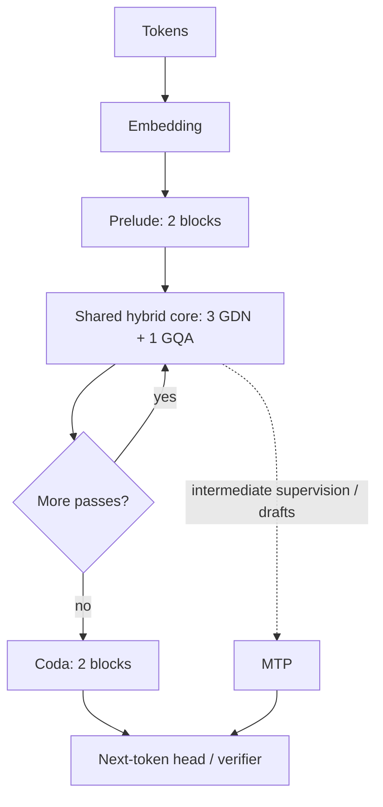

# RFC 0001 — Foundations of SPLOT
Status: historical draft v0.1 | 2026-11-26 | [Polski](pl.md)

Proposed consolidated successor: [architecture contract v0.2](contract-v0.2.md).

## Goal and non-goals
Test quality, memory, compute, energy and latency tradeoffs using a configurable decoder-only architecture. Native MTP is required in the first research generation; multimodality, production kernels, adaptive per-token halting and large offloaded models are deferred until correctness gates pass. No claim that combining existing techniques is novel.

## Forward specification
Let tokens x have shape [B,T], embedding E have shape [V,d], and z=P(E[x]) in R^(B,T,d), where P is two distinct prelude blocks. Define h_0=z and h_(r+1)=C(h_r + a_r z) for r=0..R-1. C is a shared four-block stack; a_r is a configurable injection scale (zero baseline). A learned depth embedding is a candidate, not required. Final logits are Coda(h_R) E^T after final normalization, with tied embeddings. Two coda blocks are unique. Physical depth 8; logical executions 4+4R. R=1..4 initially fixed across a sequence; train across depth only after fixed-depth correctness. For any block, use residual pre-normalization and a mixer followed by FFN; exact equations of GDN, gating and normalization to be specified in RFC 0003. Avoid in-place mutation that breaks gradients across passes.

## Attention and expert design
GDN recurrent token mixer maintains a matrix-valued state; full GQA periodically retains token-level information. Distinguish sequence-time recurrence (GDN) from depth recurrence (shared C). Draft config: d=768, 12 Q heads, 4 KV heads, head dim 64; GQA RoPE theta 1e6. GDN projection/state dimensions remain TBD; use a verified reference kernel and test chunk vs recurrent equivalence. Begin full GQA; sparse/sliding/latent attention are subsequent ablations. Four recurrent blocks may each have routed MoE; prelude/coda initially dense.

Router p=softmax(W_r h), top-k S, normalize selected weights, y=f_shared(h)+sum_(i in S) p_i/sum_(j in S)p_j * f_i(h). Eight routed and one shared expert, k=2; intermediate expert width 1024 (dense width 2048). Each SwiGLU FFN with no biases has 3dm parameters. Router scores and reductions FP32; select deterministic tie handling and monitor utilization, entropy, dead experts, overflow. Start auxiliary balancing; alternative bias-based balancing later. 3 of 9 expert FFNs execute per token, not one-third of total model FLOPs. Use grouped GEMMs when verified, but retain a slow correctness oracle.

## Parameter accounting
Tied embeddings V*d = 25,165,824 at V=32768,d=768. One expert 3*768*1024=2,359,296; nine experts * four blocks =84,934,656. Four dense FFNs with width 2048 =18,874,368. These terms alone total 128,974,848, before attention/GDN/router/norms/MTP. Target ~150M is a hypothesis; report exact counts from implementation and separate unique resident, active-per-pass, logical execution and output projection FLOPs. With R>1, repeat compute but not physical parameters.

## State semantics and correctness
For fixed R, cache key is (physical block, logical pass, sequence); GQA KV and GDN state are pass-specific. Prefill and decode must implement the same causal function. No single cache may be overwritten across logical passes. GDN rollback after rejected drafts must restore exact prefix state (snapshots or recomputation); KV suffix truncate is insufficient. Adaptive depth across tokens changes cache semantics; do not enable without a defined causal policy. Verify full vs incremental logits within declared dtype tolerance, packed-document isolation, gradient flow through shared weights, deterministic replay, batch isolation and speculative rejection/rollback. Use FP32 reference tests before BF16.

## Objective and staged precision
L = L_NTP + lambda_m L_MTP + lambda_b L_balance + lambda_l L_locality + lambda_c L_compute. Initially locality and compute coefficients zero. Locality proxy could be 1 - sum_i min(p_(r,i), p_(r-1,i)) at the same block across passes; compare with hardware cache cost; avoid constraining necessary expert switching. Fixed loop baseline cannot learn halting via a compute term alone. Train BF16; FP8 after baseline, QAT with simulated FP4 later. Master states and gradients require independent accounting.

## Research gates
1. Dense baseline and document-level holdout; verify causality.
2. Shared core with fixed R and native MTP, validate loss/masks and cache correctness.
3. Hybrid mixer and MoE independently, then jointly; compare matched compute and parameter budgets.
4. Exact speculative decoding and measured speedup/acceptance including state restoration.
5. Locality, adaptive depth and quantization experiments only after gates 1–4.

## Open decisions
GDN exact state sizes; MTP supervision and draft topology (RFC 0005); loop normalization and input injection; expert dispatch and balance; tokenizer and data rights; numerical formats; hardware routing prior art. See literature register. No training results yet.
